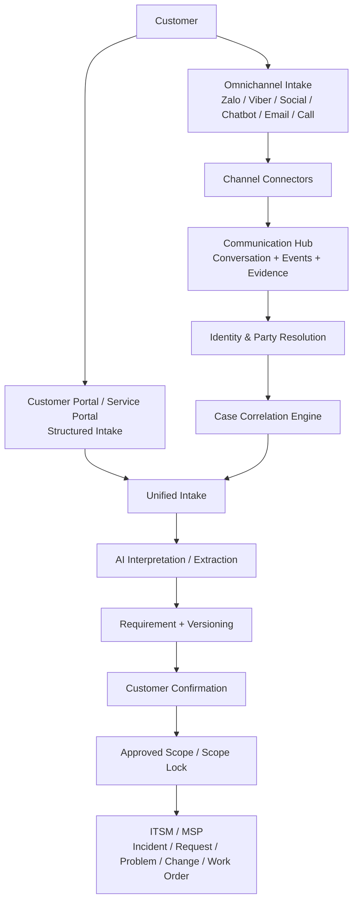

# Customer ITSM / MSP Management Platform — Omnichannel & Data-Control Blueprint

> Blueprint kiến trúc cho nền tảng Customer ITSM/MSP: Customer Portal + Service Portal + Omnichannel Intake + Communication Hub + Identity Resolution + Case Correlation + AI + Requirement Governance + ITSM/MSP Execution.

## Mục tiêu

Giải quyết triệt để bài toán:

- Khách hàng tạo yêu cầu có cấu trúc trên Customer Portal / Service Portal.
- Khách có thể tiếp tục trao đổi qua Zalo, Viber, Social, Web Chatbot, Email hoặc Call.
- Không tạo Ticket trùng khi khách đổi kênh.
- Không để Sales/CS trở thành "người truyền tin" duy nhất từ khách đến IT.
- Giữ bằng chứng gốc (message, email, audio, attachment).
- Phân biệt rõ **Customer Fact**, **AI Interpretation**, **Human Interpretation** và **Approved Requirement**.
- Chỉ dữ liệu đã được xác thực/xác nhận mới được dùng làm Approved Scope và Work Order.
- Có Data Lineage để truy ngược từ Work Order → Scope → Requirement → Conversation → Evidence.

## Kiến trúc cốt lõi

## Nguyên tắc kiến trúc

1. **Channel ≠ Customer** — Zalo ID, email, phone, Viber ID chỉ là Channel Identity.
2. **Customer Identity ≠ Contract** — khách vãng lai vẫn có Interaction Identity tạm thời.
3. **One Customer / Case, Multiple Channels** — một Case có thể có Portal + Zalo + Call + Email.
4. **Raw Evidence Never Deleted** — dữ liệu gốc không bị overwrite bởi AI/Sales.
5. **AI ≠ Source of Truth** — AI chỉ phân tích/đề xuất.
6. **Every Important Fact Has a Source** — field quan trọng phải truy được nguồn.
7. **No Approved Scope → No Execution** — IT chỉ thực thi Scope đã được xác nhận.
8. **Low-confidence correlation must not auto-link** — mapping không chắc phải hỏi người dùng/agent.
9. **Requirement is versioned** — thay đổi yêu cầu tạo version mới, không overwrite lịch sử.
10. **Communication Hub is not a ticket generator** — Hub là lớp dữ liệu giao tiếp/correlation; ITSM mới quyết định Case/Work.

## Các tài liệu chính

| Tài liệu | Nội dung |
|---|---|
| [`docs/01-architecture/01-overall-blueprint.md`](docs/01-architecture/01-overall-blueprint.md) | Kiến trúc tổng thể và luồng nghiệp vụ |
| [`docs/02-omnichannel/01-channel-integration.md`](docs/02-omnichannel/01-channel-integration.md) | Thiết kế Connector cho Zalo/Viber/Social/Chatbot/Email/Call |
| [`docs/02-omnichannel/02-case-correlation-and-identity.md`](docs/02-omnichannel/02-case-correlation-and-identity.md) | Identity, khách vãng lai, mapping Case, duplicate prevention |
| [`docs/03-call/01-call-recording-stt-ai.md`](docs/03-call/01-call-recording-stt-ai.md) | Call Recording, dual-channel, STT, transcript và Call QA |
| [`docs/04-data-governance/01-data-provenance-and-control.md`](docs/04-data-governance/01-data-provenance-and-control.md) | Data provenance, validation, approval, audit và scope lock |
| [`docs/05-data-model/01-logical-data-model.md`](docs/05-data-model/01-logical-data-model.md) | Logical data model cho Party / Communication / Case / ITSM |
| [`docs/06-implementation/01-roadmap-and-delivery.md`](docs/06-implementation/01-roadmap-and-delivery.md) | Roadmap triển khai theo phase và cách test |
| [`docs/07-vendors/01-vendor-matrix.md`](docs/07-vendors/01-vendor-matrix.md) | Ma trận nhà cung cấp và lựa chọn khuyến nghị |
| [`docs/08-bod/01-executive-summary.md`](docs/08-bod/01-executive-summary.md) | Phiên bản trình BOD: tại sao làm, lợi ích, KPI, rủi ro |
| [`docs/09-developer/01-api-and-event-contract.md`](docs/09-developer/01-api-and-event-contract.md) | Contract/API để Dev triển khai Connector và Hub |

## Phương án triển khai khuyến nghị

### Core do Công ty sở hữu

- Customer Portal / Service Portal
- Identity & Party Management
- Communication Hub
- Case Correlation Engine
- Requirement / Approval / Scope Governance
- ITSM / MSP workflow
- Audit / Data Lineage

### Vendor / Connector

- **Zalo:** Official Account API / webhook.
- **Viber:** Bot/Business API.
- **Social:** Meta/official channel APIs.
- **Email:** Microsoft Graph hoặc Gmail API; ưu tiên webhook/change notifications.
- **Call:** PBX + CDR + Call Recording; sau đó STT bằng Azure Speech, AWS Contact Lens hoặc Google Speech-to-Text.

### Lựa chọn Call/AI sơ bộ

- **Azure Speech + Language:** phù hợp khi muốn giữ Communication Hub và business logic do Công ty sở hữu; Azure hỗ trợ call-center transcription, diarization, speaker identification và hậu xử lý bằng Language. Xem `docs/03-call/01-call-recording-stt-ai.md`.
- **Amazon Connect Contact Lens:** phù hợp khi muốn voice/chat/email analytics và agent QA ở mức Contact Center; AWS hiện hỗ trợ conversational analytics cho tiếng Việt và có external-voice analytics trong phạm vi khu vực/tính năng được hỗ trợ.
- **Google Speech-to-Text:** phù hợp khi cần một STT engine độc lập và tự xây pipeline analytics.

## Lưu ý pháp lý và vận hành

- Call Recording cần triển khai phù hợp quy định pháp luật, chính sách thông báo/đồng ý và yêu cầu bảo mật dữ liệu của Công ty.
- Không lưu secret/API key vào Git.
- Audio, attachment và raw payload nên nằm ở Object Storage với checksum và retention policy.
- Có phân quyền rõ giữa Raw Evidence, AI-derived Data và Approved Data.

## Thành công được đo bằng gì?

- Tỷ lệ duplicate Case.
- Tỷ lệ Conversation được link đúng Case.
- Tỷ lệ Requirement có Source/Evidence.
- Tỷ lệ Approved Scope có Customer Confirmation.
- Tỷ lệ Work Order vượt Scope.
- Tỷ lệ Call được ghi âm + transcript.
- Tỷ lệ AI extraction phải chỉnh sửa thủ công.
- First Response Time / Resolution Time / SLA Compliance.
- CSAT và Call QA score.
- Số Incident lặp lại.

## Tư duy thiết kế

> **Capture → Identify → Correlate → Interpret → Validate → Confirm → Lock → Execute → Verify → Improve**
