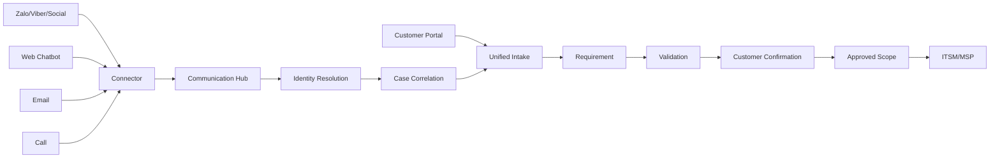

# 01 — Overall Blueprint: Customer ITSM / MSP Management Platform

## 1. Executive design decision

Nền tảng được chia thành hai loại đầu vào:

- **Structured Intake:** Customer Portal / Service Portal. Khách nhập dữ liệu theo form có cấu trúc.
- **Omnichannel Intake:** Zalo, Viber, Social, Web Chatbot, Email, Call. Dữ liệu ban đầu là unstructured hoặc semi-structured và cần Connector + Communication Hub.

Hai luồng **không tạo hai hệ thống Ticket độc lập**. Chúng hội tụ vào **Unified Intake** và cùng sử dụng Case/Requirement/Approval/SLA/ITSM.

## 2. Nguyên tắc "One Case, Multiple Channels"

Một yêu cầu có thể phát sinh trên Portal rồi tiếp tục trao đổi ở Zalo, sau đó gọi điện, rồi gửi email bổ sung. Hệ thống phải giữ:

```text
CASE-00125
│
├── Portal Request
├── Zalo Conversation
├── Phone Call
└── Email Thread
```

Không được tạo:

```text
REQ-00125  Portal
REQ-00126  Zalo
REQ-00127  Call
REQ-00128  Email
```

trừ khi hệ thống xác định đây thực sự là các yêu cầu khác nhau.

## 3. Các lớp hệ thống

### 3.1. Channel Layer

- Customer Portal
- Service Portal
- Zalo OA
- Viber
- Facebook / Social
- Web Chatbot
- Email
- PBX / Contact Center

### 3.2. Channel Integration Layer

Mỗi channel có một Connector chuyên trách:

```text
Zalo Webhook → Zalo Connector
Viber Webhook/API → Viber Connector
Meta Webhook → Social Connector
Web Chatbot API → Chatbot Connector
Microsoft Graph → Email Connector
PBX CDR + Recording → Call Connector
```

Connector có nhiệm vụ:

1. Validate authentication/signature.
2. Lưu raw event.
3. Normalize về canonical event model.
4. Chống duplicate bằng external event ID.
5. Đẩy event vào queue.
6. Acknowledge nguồn càng sớm càng tốt.

### 3.3. Communication Hub

Communication Hub không phải ticket engine. Nó lưu:

- Conversation.
- Communication Event.
- Attachment.
- Raw Evidence.
- Call Recording metadata.
- Transcript reference.
- Channel identity.

### 3.4. Identity & Party Management

Tách khỏi Contract.

```text
Interaction Identity
        ↓
Contact
        ↓
Organization
        ↓
Prospect / Customer
        ↓
Contract / Service Entitlement
```

Khách vãng lai có thể tạo Interaction Identity và Case trước khi được xác minh.

### 3.5. Case Correlation Engine

Nhiệm vụ: xác định communication event mới thuộc Case nào.

Ưu tiên deterministic signals trước AI.

```text
Case ID / explicit reference
        ↓
Conversation ID / Email Thread ID
        ↓
Verified Identity
        ↓
Service / Asset / Location / Time context
        ↓
Semantic AI match
```

### 3.6. Unified Intake

Unified Intake tiếp nhận hai nguồn:

```text
Portal structured request ─┐
                           ├→ Unified Intake
Omnichannel correlated ────┘
```

Từ đây mới chuyển sang:

- Requirement.
- Validation.
- Customer Confirmation.
- Approved Scope.
- ITSM process.

## 4. Luồng chuẩn



## 5. Case state machine đề xuất

```text
NEW
 ↓
TRIAGED
 ↓
NEED_INFORMATION ─────────────┐
 ↓                            │
REQUIREMENT_DRAFT             │
 ↓                            │
CUSTOMER_CONFIRMATION         │
 ↓                            │
APPROVED_SCOPE                │
 ↓                            │
IN_PROGRESS                   │
 ↓                            │
VALIDATION                    │
 ↓                            │
CUSTOMER_ACCEPTANCE           │
 ↓                            │
RESOLVED / CLOSED             │
                              │
REJECTED / CANCELLED ←────────┘
```

## 6. Không để Sales trở thành data bus

Sales/CS vẫn là Business Owner/Relationship Owner nhưng không được là nguồn duy nhất truyền thông tin cho IT.

Sales có thể:

- hỏi thêm khách;
- bổ sung context;
- quản lý thương mại;
- đề xuất scope;
- làm rõ expectation.

Nhưng dữ liệu gốc phải vẫn tồn tại trong Communication Hub và mọi thay đổi quan trọng phải có source/evidence.

## 7. Scope Lock

Khi khách xác nhận Requirement cuối:

```text
APPROVED_SCOPE = LOCKED
```

IT chỉ thực hiện những gì nằm trong Scope.

Nếu cần làm thêm:

```text
Technical Recommendation
        ↓
Additional Approval / Change
        ↓
Updated Scope Version
        ↓
Work Order
```

## 8. Exception: Major/Emergency Incident

Không áp dụng "No Approved Scope → No Execution" một cách tuyệt đối cho Major Incident/Emergency.

Phải có Emergency Change path:

```text
Major Incident
 ↓
Emergency Decision
 ↓
Emergency Change
 ↓
Execute
 ↓
Retrospective Review
```

## 9. Security boundaries

- Raw customer data: immutable, restricted.
- AI-derived data: labeled as derived/proposed.
- Approved data: controlled by business/service authority.
- IT execution: only from approved scope.
- Audit log: append-only.

## 10. Anti-patterns phải tránh

### Anti-pattern 1: Channel → Ticket trực tiếp

Tạo duplicate và mất correlation.

### Anti-pattern 2: Sales copy/paste vào Ticket

Mất provenance.

### Anti-pattern 3: AI tự biến guess thành requirement

Biến interpretation thành fact.

### Anti-pattern 4: Xóa Raw Message/Recording sau khi summary

Không còn forensic evidence.

### Anti-pattern 5: Dùng Contract để định danh mọi khách

Không xử lý khách vãng lai/prospect.

## 11. Thiết kế triển khai khuyến nghị

### Core Platform do Công ty sở hữu

- Party/Identity.
- Customer/Contract.
- Communication Hub.
- Case Correlation.
- Requirement Governance.
- ITSM/MSP.
- Audit/Data Lineage.

### Connector/Vendor

Được thay thế độc lập. Không vendor nào được trở thành source of truth cho business case.

## 12. Definition of Done cho kiến trúc

Kiến trúc chỉ được coi là đạt khi có thể trả lời:

1. Khách đã nói gì?
2. Nói ở kênh nào?
3. Ai nói?
4. Khi nào?
5. Nó thuộc khách/identity nào?
6. Thuộc Conversation nào?
7. Thuộc Case nào?
8. AI đã suy luận gì?
9. Khách đã xác nhận gì?
10. Công ty thực hiện đúng Scope nào?
11. Ai thay đổi dữ liệu và lúc nào?
12. Có bằng chứng gốc không?
