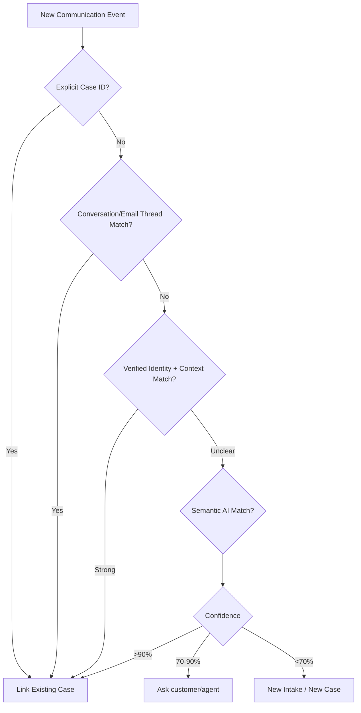

# 02.02 — Identity Resolution & Case Correlation

## 1. Why this module exists

Omnichannel chỉ có giá trị khi hệ thống biết:

1. Ai đang liên hệ?
2. Người này thuộc tổ chức nào?
3. Đã có Case nào liên quan?
4. Message/Call mới nên link vào Case cũ hay tạo Case mới?

Nếu thiếu module này, mỗi kênh sẽ tạo một luồng Ticket riêng và gây duplicate.

## 2. Identity is not Contract

Không dùng `Customer = Contract holder` làm điều kiện tạo Case.

### Định nghĩa

```text
Interaction Identity
      ↓
Contact / Person
      ↓
Organization
      ↓
Prospect / Customer relationship
      ↓
Contract / Service entitlement
```

### Khách vãng lai

Khách vãng lai có thể có:

```text
INT-000999
status = UNKNOWN
phone = 090...
channel = PHONE
```

và vẫn tạo được Case:

```text
CASE-000500
requester_identity = INT-000999
customer_id = NULL
```

Sau khi xác minh có thể attach Interaction Identity vào Contact/Organization/Customer.

## 3. Channel identity table

Bảng logic:

```text
interaction_identities
----------------------
id
channel
external_id
customer_id (nullable)
contact_id (nullable)
organization_id (nullable)
verification_status
match_confidence
first_seen_at
last_seen_at
```

Ví dụ:

```text
ZALO     ZL98765      CUS-00025
PHONE    0901234567   CUS-00025
EMAIL    a@abc.vn     CUS-00025
VIBER    VB12345      CUS-00025
PORTAL   USER-123     CUS-00025
```

## 4. Verification strategy

Không merge chỉ vì tên giống nhau.

Mức xác thực đề xuất:

| Match | Confidence tham khảo |
|---|---:|
| Case ID / explicit reference | 100% |
| Verified portal identity | 100% |
| Verified channel identity | 95–100% |
| Verified phone/email | 95% |
| Contact + organization match | 90% |
| Name only | thấp |
| AI semantic guess | không đủ để định danh |

Ngưỡng phải được hiệu chỉnh bằng dữ liệu thật.

## 5. Case Correlation

### Mục tiêu

Map:

```text
Communication Event → Existing Case / New Case
```

### Thứ tự ưu tiên



## 6. Ví dụ Portal → Zalo → Call → Email

### Portal

```text
CASE-00125
Service = Website
Issue = Website slow
```

### Zalo

Khách: "Cái yêu cầu website sáng nay thế nào rồi?"

Identity → CUS-00025.

Open Case context → CASE-00125.

→ Link Zalo Conversation vào CASE-00125.

### Call

Caller → same verified identity.

Transcript: "Website vẫn chậm, kiểm tra giúp anh."

Semantic match + same open Case → link Call vào CASE-00125.

### Email

Subject: `Re: [CASE-00125] Website slow`.

Message/Thread ID → deterministic link.

Kết quả:

```text
CASE-00125
├── Portal Request
├── Zalo Conversation
├── Call Recording + Transcript
└── Email Thread
```

## 7. Trường hợp Case mới

Khách đang có:

```text
CASE-00125 = Website slow
```

Nhưng Zalo nói:

> "Còn một việc nữa: VPN của nhân viên không vào được."

Service/topic/CI khác.

→ tạo `CASE-00126`.

## 8. Multi-open-case ambiguity

Nếu khách nói:

> "Cái vụ hôm trước làm tiếp giúp anh."

và có 5 Case mở:

```text
CASE-00120 Website
CASE-00122 Email
CASE-00125 Microsoft 365
CASE-00127 Network
CASE-00129 VPN
```

Không auto-link.

Bot/agent hỏi:

> "Anh đang nói về yêu cầu VPN (CASE-00129) đúng không ạ?"

Khách xác nhận → link.

## 9. Correlation record

Mọi mapping phải có evidence:

```text
correlation_id
communication_event_id
candidate_case_id
decision
confidence
reasons[]
model_version
approved_by (nullable)
created_at
```

Ví dụ:

```text
Decision = LINK
Confidence = 0.96
Reasons:
- same verified identity
- same service
- case open
- same conversation context
```

## 10. Duplicate prevention

Trước khi tạo Case mới:

1. kiểm tra explicit Case ID;
2. kiểm tra active Conversation;
3. kiểm tra email thread;
4. tìm active Cases cùng Customer + Service + Asset;
5. semantic duplicate detection;
6. chỉ tạo Case mới nếu không có candidate phù hợp.

## 11. Không dùng AI làm lớp đầu tiên

AI chỉ chạy sau khi deterministic matching không đủ.

Đây là nguyên tắc quan trọng để giảm false positives.

## 12. Identity lifecycle

```text
UNKNOWN
  ↓ verify
IDENTIFIED
  ↓ organization match
PROSPECT / CUSTOMER
  ↓ contract
CONTRACTED CUSTOMER
```

Case/Conversation không bị xóa hoặc thay ID khi identity được nâng cấp.

## 13. Privacy và data minimization

- Chỉ lưu identity attributes thực sự cần.
- Tách PII khỏi analytics nếu có thể.
- Không log full message vào application log.
- Raw payload có retention policy.
- Audio có encryption + access control.

## 14. Acceptance criteria

- Cùng Case qua 3–5 kênh vẫn không tạo duplicate.
- Khách vãng lai vẫn tạo được Case.
- Identity chưa xác minh không được tự gán vào Customer sai.
- Case mapping <70% confidence không auto-link.
- Mọi auto-link có correlation evidence.
- Có thể audit lý do hệ thống chọn Case nào.
