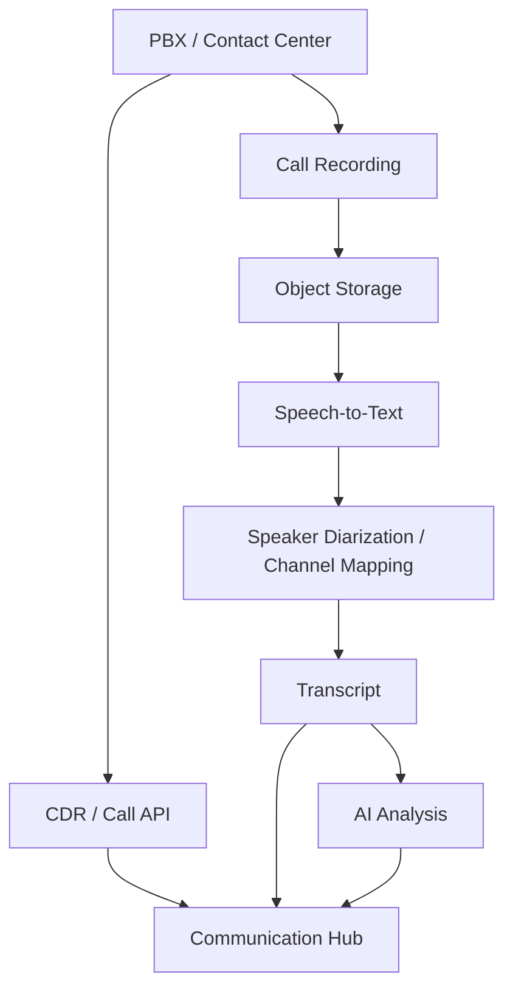

# 03.01 — Call Recording → STT → AI → Communication Hub

## 1. Why Call is different

Các kênh Zalo/Email/Chatbot thường có text gốc. Call chỉ có text nếu hệ thống thoại cung cấp:

1. Call metadata (CDR/API/AMI).
2. Audio recording hoặc media stream.
3. Speech-to-Text.

Chỉ có CDR thì biết cuộc gọi diễn ra nhưng không biết nội dung.

## 2. Recording architecture



## 3. Dual-channel recommendation

Nếu PBX hỗ trợ dual-channel/stereo:

```text
Track 1 = Customer
Track 2 = Company Agent
```

hoặc recording tương đương với inbound/outbound channel.

Lợi ích:

- Không cần đoán speaker bằng AI.
- Giảm nhầm người đưa ra cam kết.
- Có thể đối chiếu chính xác Customer vs Agent.
- Tốt cho Call QA.

Nếu chỉ có mono, dùng diarization; Azure Speech hỗ trợ diarization cho mono audio trong post-call workflow. Xem Microsoft reference ở cuối file.

## 4. Data model for call

```text
call
├── call_id
├── customer_identity_id
├── agent_id
├── direction
├── start_time
├── answer_time
├── end_time
├── duration
├── status
├── recording_id
└── conversation_id

call_recording
├── recording_id
├── call_id
├── storage_uri
├── format
├── duration
├── channel_count
├── checksum
├── retention_until
└── created_at

transcript
├── transcript_id
├── call_id
├── language
├── model
├── model_version
└── created_at

transcript_segment
├── segment_id
├── transcript_id
├── speaker_role
├── channel
├── start_ms
├── end_ms
├── text
└── confidence
```

## 5. Transcript target

Tốt nhất:

```text
00:00 CUSTOMER
Website bên anh chạy chậm.

00:05 COMPANY
Anh bắt đầu gặp từ lúc nào?

00:09 CUSTOMER
Khoảng 9 giờ sáng.
```

Nếu mono diarization:

```text
SPEAKER_1
SPEAKER_2
```

sau đó Map Speaker → Customer/Agent bằng call context.

## 6. AI pipeline

```text
Audio
 ↓
Transcript
 ↓
Speaker mapping
 ↓
Language normalization
 ↓
PII detection/redaction
 ↓
Intent classification
 ↓
Requirement extraction
 ↓
Time/quantity/scope extraction
 ↓
Case correlation
 ↓
Risk/compliance analysis
 ↓
Summary / Call QA
```

## 7. AI must not silently promote facts

Ví dụ Customer nói:

> "Mai khoảng 8 hoặc 9 giờ."

AI không được ghi thẳng:

```text
requested_time = 08:00
```

Mà phải tạo:

```text
candidates = [08:00, 09:00]
confidence = low/medium
verification = REQUIRED
```

Chỉ sau Customer Confirmation mới chốt:

```text
requested_time = 09:00
status = APPROVED
```

## 8. Call QA / Call Rating

Có thể tự xây scoring:

| Tiêu chí | Ví dụ |
|---|---|
| Greeting | Có xác nhận khách |
| Requirement discovery | Hỏi đủ thông tin |
| Time/date accuracy | Không làm sai mốc thời gian |
| Scope discipline | Không tự cam kết ngoài Scope |
| Confirmation | Có đọc lại/verify |
| Compliance | Tuân thủ script/chính sách |
| Resolution | Có action rõ |
| Customer experience | Sentiment/CSAT |

Score 0–100 hoặc theo rubric 1–5.

## 9. Customer Rating + AI QA

Tách hai chỉ số:

### Customer Rating

Khách đánh giá 1–5 sau cuộc gọi.

### AI Call QA

AI đánh giá cuộc gọi dựa trên transcript/metadata.

Hai chỉ số không được trộn làm một:

```text
Customer satisfaction = perception
Call QA = process quality/compliance
```

## 10. Vendor option A — Azure

Azure Foundry Tools for Speech/Language hiện cung cấp call-center features như real-time speech-to-text, batch transcription, speaker diarization, speaker identification và language identification; Azure Language có thể tiếp tục phân tích sentiment, summarization, PII extraction/redaction và issue resolution. citeturn562621search0turn562621search5

**Phù hợp nhất khi:** Công ty muốn giữ Communication Hub và business logic của riêng mình.

```text
PBX Recording
 ↓
Azure Speech
 ↓
Transcript
 ↓
Azure Language
 ↓
Communication Hub
```

## 11. Vendor option B — Amazon Connect Contact Lens

Amazon Connect Contact Lens hỗ trợ conversational analytics cho voice/chat/email; transcript, sentiment, issue detection và categorization. Tiếng Việt hiện nằm trong danh sách ngôn ngữ conversational analytics được hỗ trợ. citeturn398889search0turn398889search12

AWS cũng hỗ trợ external voice analytics cho các hệ thống thoại hiện hữu ở phạm vi khu vực được công bố; điều này hữu ích nếu chưa muốn thay PBX ngay. citeturn398889search11

Contact Lens có thể cung cấp transcript và performance analytics, kể cả chỉ số về talk time/interruption và automated agent evaluations. citeturn398889search4turn398889search10

## 12. Vendor option C — Google Speech-to-Text

Dùng Google Speech-to-Text làm engine STT độc lập, sau đó tự xử lý semantic analysis và requirement governance.

Mô hình:

```text
PBX Recording
 ↓
Google STT
 ↓
Transcript
 ↓
AI / LLM
 ↓
Communication Hub
```

Ưu điểm: tách STT vendor khỏi Contact Center platform.

## 13. Khuyến nghị lựa chọn

### Nếu muốn tự chủ Platform

**PBX hiện tại + Recording + Azure Speech/Language + Communication Hub tự xây.**

### Nếu muốn Contact Center analytics nhiều tính năng sẵn

**Amazon Connect Contact Lens.**

### Nếu muốn thay PBX/CCaaS đồng bộ enterprise

Có thể đánh giá Genesys/NiCE/nhà cung cấp CCaaS, nhưng phải test tiếng Việt và API/export transcript trước khi ký.

## 14. Recording policy

- Thông báo/đồng ý theo chính sách và pháp luật áp dụng.
- Encryption at rest/in transit.
- Retention period.
- Role-based access.
- Audit every playback/download.
- Watermark/export control nếu cần.
- Raw audio immutable.
- Checksum/hash để phát hiện sửa file.

## 15. Acceptance criteria cho Call

- 100% call business-critical có Call ID.
- Có recording hoặc media evidence cho luồng yêu cầu cần audit.
- Recording map được về Customer/Conversation/Case.
- Transcript map được về timestamp audio.
- Speaker role được xác định hoặc có confidence.
- AI-derived fields được gắn source + confidence.
- Không thể tạo Approved Scope chỉ từ transcript chưa xác nhận.

## References

- Microsoft Foundry Tools for Call Center: https://learn.microsoft.com/en-us/azure/ai-services/speech-service/call-center-overview
- Microsoft post-call transcription quickstart: https://learn.microsoft.com/en-us/azure/ai-services/speech-service/call-center-quickstart
- AWS Contact Lens conversational analytics: https://docs.aws.amazon.com/connect/latest/adminguide/analyze-conversations.html
- AWS Contact Lens external voice: https://aws.amazon.com/about-aws/whats-new/2024/12/amazon-connect-contact-lens-external-voice/
