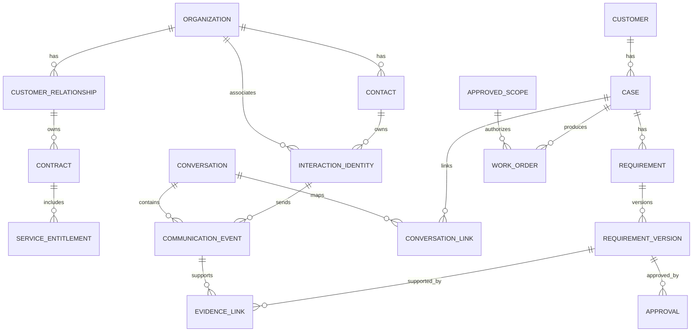

# 05.01 — Logical Data Model

## 1. Domain model



## 2. Main entities

### Organization

```text
id
legal_name
trading_name
external_code
status
created_at
updated_at
```

### Contact

```text
id
organization_id
full_name
email
phone
job_title
status
verified_at
```

### Interaction Identity

Represents identity on a channel, not a contract.

```text
id
channel
external_id
contact_id
organization_id
customer_id
verification_status
confidence
first_seen_at
last_seen_at
```

### Customer Relationship

Represents the business relationship.

```text
id
organization_id
relationship_type   # prospect/customer/etc.
status
start_at
end_at
```

### Contract

```text
id
customer_relationship_id
contract_number
start_at
end_at
status
sla_policy_id
```

### Service Entitlement

```text
id
contract_id
service_id
support_hours
response_target
resolution_target
priority_policy
```

## 3. Communication entities

### Channel

```text
id
code
name
provider
active
```

Ví dụ:

```text
PORTAL
ZALO
VIBER
SOCIAL
WEB_CHAT
EMAIL
PHONE
```

### Conversation

```text
id
customer_id
primary_case_id
channel_origin
status
subject
started_at
last_activity_at
```

Một Case có thể có nhiều Conversation.

### Communication Event

Canonical message/event model:

```text
id
conversation_id
case_id nullable
channel_id
interaction_identity_id
external_event_id
external_thread_id
direction
sender_type
content_type
content
external_timestamp
received_at
raw_event_id
created_at
```

### Raw Event

```text
id
channel_id
external_event_id
payload_uri
payload_hash
received_at
processing_status
```

### Attachment

```text
id
communication_event_id
file_name
mime_type
size
storage_uri
sha256
created_at
```

## 4. Call entities

### Call

```text
id
communication_event_id
call_external_id
caller
callee
agent_id
direction
start_time
answer_time
end_time
duration
status
recording_id
```

### Call Recording

```text
id
call_id
storage_uri
format
channel_count
duration
sha256
retention_until
```

### Transcript

```text
id
call_id
language
provider
model
model_version
status
created_at
```

### Transcript Segment

```text
id
transcript_id
speaker_role
channel
start_ms
end_ms
text
confidence
```

## 5. Case / Requirement entities

### Case

```text
id
case_number
customer_id nullable
requester_identity_id
type
service_id
category
priority
status
opened_at
closed_at
source
```

Case must be possible for anonymous/unknown requester.

### Requirement

```text
id
case_id
current_version_id
status
created_at
updated_at
```

### Requirement Version

```text
id
requirement_id
version_no
statement
structured_payload
source_event_id
created_by_type
created_by_id
confidence
validation_status
approved_at
approved_by
created_at
```

### Evidence Link

```text
id
requirement_version_id
communication_event_id
portal_submission_id
recording_id
email_message_id
relationship_type
created_at
```

## 6. Approval / Scope

### Approval

```text
id
requirement_version_id
approver_type
approver_id
approval_type
status
approved_at
source_event_id
```

### Approved Scope

```text
id
case_id
requirement_version_id
scope_version
scope_payload
status
locked_at
locked_by
```

## 7. ITSM entities

### Work Order

```text
id
case_id
approved_scope_id
assignment_group
assignee
status
planned_start
planned_end
actual_start
actual_end
```

### Change

```text
id
case_id
work_order_id
type
risk
impact
approval_status
implementation_plan
rollback_plan
```

## 8. Audit

### Audit Log

```text
id
entity_type
entity_id
action
field_name
old_value
new_value
actor_type
actor_id
source_event_id
created_at
```

## 9. Critical uniqueness/indexes

Recommended:

```text
UNIQUE(channel_id, external_event_id)
INDEX(interaction_identity_id, last_seen_at)
INDEX(conversation_id, external_timestamp)
INDEX(case_id, status)
INDEX(case_id, created_at)
INDEX(requirement_id, version_no)
UNIQUE(requirement_id, version_no)
UNIQUE(approval, requirement_version_id, approval_type)
```

## 10. Tenant/customer isolation

Nếu Platform là multi-tenant, mọi bảng business phải có `tenant_id` hoặc scope equivalent.

Index thường cần:

```text
(tenant_id, customer_id)
(tenant_id, case_id)
(tenant_id, external_event_id)
```

## 11. Storage strategy

Database:

- metadata;
- normalized event;
- correlation;
- requirement;
- audit.

Object Storage:

- raw JSON payload;
- audio recording;
- attachments;
- large transcripts if needed.

## 12. System of Record rules

- Channel vendor = source of transport event.
- Communication Hub = source of communication history.
- Customer/Contract master = source of business identity/entitlement.
- ITSM = source of operational Case/Work state.
- Approved Scope = source of execution authorization.
